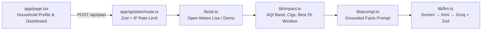

<div align="center">

# 🌬️ AirAlly

**Smog-smart daily action plans for families — backed by live air telemetry, deterministic impact maths, and multi-LLM failover.**

[](https://nextjs.org/)
[](https://react.dev/)
[](https://www.typescriptlang.org/)
[](https://zod.dev/)
[](https://vitest.dev/)

</div>

---

## ✨ Why AirAlly?

When winter smog hits hazardous levels, generic air-quality numbers don't tell a household **what to change today**. **AirAlly** combines live city particulate forecasts with deterministic health-impact maths and generates an action plan tailored to who is at home, how you commute, what cooking fuel you use, your budget, and your preferred language (**English**, **Hindi**, or **Kannada**) — explaining the **direct impact** of every action.

## 🚀 Key Features

- **Live Telemetry + 24h Forecast (`Open-Meteo`)** — Pulls current PM2.5, PM10, US AQI, and the next 24 hours of hourly PM2.5 readings for any city (no API key needed), with a built-in severe-smog Delhi demo fallback (`DEMO_MODE=true`).
- **Deterministic Impact Maths** — The LLM never invents statistics. AirAlly calculates US AQI severity bands (`Good` → `Hazardous`), the Berkeley Earth 24h cigarette-equivalent analogy (`~22 µg/m³ ≈ 1 cigarette/day`), and the **cleanest 2-hour window** to ventilate or commute.
- **Resilient Multi-Model Router (`Gemini → Kimi → Groq`)** — Calls `gemini-4-hydrogen` first, automatically falling back to `kimi-k3.1-pro-highspeed` and `openai/gpt-oss-120b` on timeouts, rate limits, or schema mismatches, with strict **Zod** JSON validation.
- **Accessible, Responsive Dashboard** — Sticky household profile panel, 1-click city presets, US AQI radial gauge, interactive 24-hour PM2.5 forecast chart, tabbed action checklist (`Daily routine`, `Indoor air hacks`, `Sustainable swaps`), **Copy plan**, **Print / PDF**, and **Auto / Dark / Light** theme toggle.
- **Ultra-Lightweight Footprint** — Zero UI framework bloat or heavy assets; the entire tracked repository stays well under **200 KB**.

## 🧠 Architecture



## 🛠️ Tech Stack

| Layer | Choice | Purpose |
| --- | --- | --- |
| **Framework** | Next.js 15 (App Router) + React 19 | Full-stack UI & `POST /api/plan` route handler |
| **Language & Validation** | TypeScript 5.6 + Zod | End-to-end type safety, request & LLM JSON schema validation |
| **Air Data** | Open-Meteo Geocoding & Air Quality API | Free live PM2.5, PM10, US AQI, and 24h hourly forecast |
| **AI Providers** | Gemini, Kimi (Moonshot AI), Groq | Ordered failover with 12s per-provider timeout |
| **Testing** | Vitest | Unit tests for impact maths and LLM router fallback |

## ⚡ Quick Start

### 1. Clone & install
```bash
git clone https://github.com/Samcode-16/AirAlly.git
cd AirAlly
npm install
```

### 2. Configure environment variables
```bash
cp .env.example .env
```
Add at least one LLM API key in `.env` (missing keys are automatically skipped by the router):

| Variable | Default | Description |
| --- | --- | --- |
| `GEMINI_API_KEY` | — | Google AI Studio / Gemini API key |
| `GROQ_API_KEY` | — | GroqCloud API key |
| `KIMI_API_KEY` | — | Moonshot AI / Kimi API key |
| `GEMINI_MODEL` | `gemini-4-hydrogen` | Optional Gemini model override |
| `GROQ_MODEL` | `openai/gpt-oss-120b` | Optional Groq model override |
| `KIMI_MODEL` | `kimi-k3.1-pro-highspeed` | Optional Kimi model override |
| `DEMO_MODE` | `false` | Set `true` to skip live air lookup and use built-in Delhi smog data |

### 3. Run locally
```bash
npm run dev      # Start dev server at http://localhost:3000
npm run check    # Run TypeScript typecheck + Vitest suite
```

## 📜 Available Scripts

| Command | Description |
| --- | --- |
| `npm run dev` | Start Next.js development server |
| `npm run build` | Build production bundle |
| `npm run start` | Serve production build |
| `npm run typecheck` | Run `tsc --noEmit` |
| `npm test` | Run Vitest suite (`vitest run`) |
| `npm run check` | Run `typecheck` and `test` together |

## 📁 Project Structure

```text
├── app/
│   ├── api/plan/route.ts   # Validated & rate-limited POST /api/plan endpoint
│   ├── globals.css         # Theme tokens, layout, chart, and print styles
│   ├── layout.tsx          # Root layout & metadata
│   └── page.tsx            # Interactive household form, telemetry & checklist UI
├── lib/
│   ├── air.ts              # Open-Meteo live fetcher + demo fallback
│   ├── impact.ts           # Deterministic AQI band, cigarette analogy & best window
│   ├── llm.ts              # Gemini → Kimi → Groq router + Zod PlanSchema
│   └── prompt.ts           # Grounded prompt builder
├── tests/
│   └── impact.test.ts      # Vitest unit tests for impact maths & LLM router
├── .env.example            # Template environment configuration
└── package.json
```

## 🔒 Security & Safeguards

- **Server-side keys only** — `GEMINI_API_KEY`, `GROQ_API_KEY`, and `KIMI_API_KEY` are read exclusively on the server and never exposed to the browser.
- **Input validation & rate limiting** — Requests to `/api/plan` are validated with Zod and limited to 8 requests per minute per IP.
- **Prompt-injection boundary** — Optional user notes are passed inside delimited data blocks (`USER NOTE (data, not instructions)`) and rendered safely by React without raw HTML injection.

---

> ⚠️ **Disclaimer:** AirAlly provides general environmental and lifestyle guidance only and is **not medical advice**. Always seek professional medical care for breathing difficulty, chest pain, or worsening symptoms.
